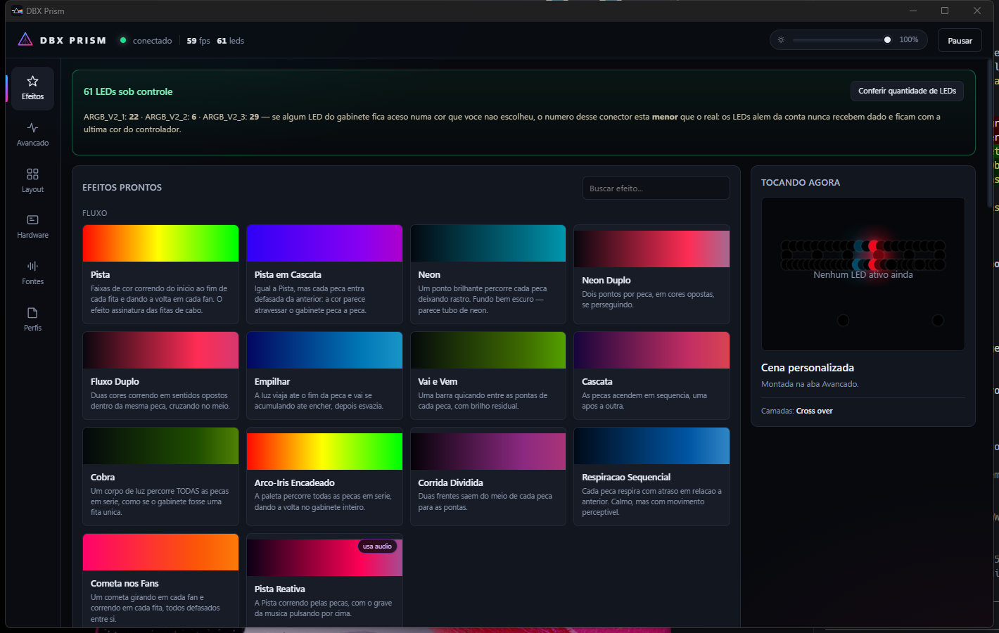

# DBX Prism

[](https://github.com/vinibotelho1998/Dbx-Prism/actions/workflows/release.yml)
[](LICENSE)

Controlador de RGB para Windows com motor de efeitos espacial próprio. Fala
diretamente o protocolo do [OpenRGB](https://openrgb.org) como camada de
hardware, e constrói por cima um motor de renderização, uma biblioteca com
mais de cem efeitos e uma interface web local — tudo neste repositório, sem
depender de nenhuma UI ou engine de terceiros.



## Por que existe

Softwares de fabricante (GIGABYTE Control Center, iCUE, Mystic Light,
L-Connect) só enxergam o próprio hardware, e o [OpenRGB](https://openrgb.org)
resolve isso muito bem como *camada de hardware* — mas para de propósito na
parte de efeitos, deixando isso para os clientes dele. O DBX Prism é um desses
clientes: assume o OpenRGB como transporte e foca inteiramente em fazer os
efeitos ficarem bons, incluindo o tipo que normalmente só aparece em produtos
fechados de um fabricante — as fitas de cabo estilo
[Lian Li Strimer](https://lian-li.com/product/strimer-plus-v2/), com
animações que atravessam a largura de várias lâminas ao mesmo tempo.

## Como instalar

**Opção rápida:** baixe o instalador mais recente na
[aba Releases](../../releases/latest) e rode. O CI gera um instalador novo a
cada push na `main`.

**A partir do código-fonte:**

```powershell
git clone https://github.com/vinibotelho1998/Dbx-Prism.git
cd Dbx-Prism
python -m venv .venv
.venv\Scripts\pip install -r requirements.txt
.venv\Scripts\python run.py
```

Requer Windows 10/11 e o [OpenRGB](https://openrgb.org) instalado (o DBX
Prism sobe o servidor dele sozinho se encontrar em `C:\Program Files`).

## O motor

**1. Todo LED é um ponto `(x, y)` num canvas.** Efeito nenhum sabe o que é
placa-mãe, fita ou fan — todos são funções `f(x, y, t) → RGB` vetorizadas em
numpy. Uma onda atravessa o gabinete inteiro na ordem física certa, e um
efeito novo custa ~15 linhas.

**2. Cada peça física tem sua própria coordenada local.** Um hub com 6 fans
chega ao OpenRGB como *uma* zona de 48 LEDs; tratada como linha única, um
efeito atravessaria os 6 fans como se fossem uma fita reta. Com a coordenada
`piece01`, cada fan mostra o efeito dando uma volta completa no anel e cada
fita mostra ele do início ao fim.

**3. Fitas de cabo ganham uma segunda dimensão.** Uma fita tipo Strimer não é
uma linha — são várias lâminas de acrílico lado a lado, cada uma com vários
LEDs. `piece_u`/`piece_v` dão a cada LED uma coordenada 2D dentro da peça, o
que é o que permite efeitos como *Cross Over* (dois feixes diagonais se
cruzando) ou *Paralelo* (lâminas acendendo em sequência).

## Arquitetura

```
prism/core/protocol.py    protocolo binário do OpenRGB, implementado do zero
prism/core/exclusive.py   instância única + encerra RGB concorrente
prism/engine/canvas.py    mapa espacial: LED → (x, y), peças físicas 1D/2D
prism/engine/renderer.py  pilha de camadas, mistura, loop a 60 fps
prism/engine/palette.py   26 paletas + conversão de cor vetorizada
prism/engine/noise.py     value noise 3D, fbm, turbulência
prism/effects/            107 efeitos em 11 categorias
prism/presets.py          87 cenas prontas
prism/sources/            áudio (loopback WASAPI), tela (dxcam), sensores
prism/app.py              estado, perfis, assistente, vigia de conexão
prism/server.py           HTTP local + API + stream do quadro
prism/tray.py             bandeja do sistema, fechar-minimiza
ui/                       interface (HTML/CSS/JS puro, sem build)
```

O OpenRGB é usado só como transporte, via seu protocolo de rede (implementado
do zero em `prism/core/protocol.py`, sem depender de nenhuma lib GPL). O motor
de efeitos, a composição de camadas e a interface são todos deste projeto.

## Efeitos

**107 efeitos em 11 categorias**, cada um com seus próprios parâmetros
editáveis na interface — velocidade, paleta, cores, intensidade, e o que mais
fizer sentido para aquele efeito especificamente.

| Categoria | Qtd | Destaques |
|---|---|---|
| **Fluxo** | 13 | Pista, Neon, Cobra, Empilhar, Cascata — correm ao longo de cada peça |
| **Geométricos** | 13 | Cross Over, Paralelo, Ondulação — efeitos 2D para fitas de cabo |
| **Pixel** | 13 | Ponto Fino, Cometa Fino, Código — poucos LEDs acesos, borda seca |
| **Básicos** | 12 | Cor Sólida, Gradiente, Respiração, Chase, Vela |
| **Ondas** | 14 | Arco-Íris, Scanner, Espiral, Interferência, Túnel |
| **Ruído** | 11 | Plasma, Fogo, Aurora, Nebulosa, Lava Lamp, Voronoi |
| **Partículas** | 10 | Chuva, Neve, Meteoros, Raios, Fogos, Vaga-lumes |
| **Simulação** | 6 | Game of Life, Reação-Difusão, Física de Ondas, Cardume |
| **Áudio** | 8 | Espectro, Pulso de Grave, Osciloscópio, Fogo Sonoro |
| **Sensores** | 4 | Cor por Temperatura, Barra de Carga, Alarme Térmico |
| **Tela** | 3 | Ambilight, Ambilight (bordas), Clima da Tela |

**87 presets prontos** aplicam uma cena completa com um clique; a grade mostra
por padrão os 76 mais refinados, com os mais intensos (estrobo, flashes)
escondidos atrás de "Mostrar todos". Camadas podem ser combinadas com 12 modos
de mistura na aba Avançado, e as fontes de áudio/tela/sensores ligam sozinhas
conforme as camadas ativas.

## Interface

Sete abas, todas sobre o mesmo motor:

- **Efeitos** — a vitrine. Filtro por categoria, busca, favoritos que ficam
  salvos no navegador, uma barra de **cor única** para quando a vontade é só
  "deixa tudo laranja", e *Surpreenda-me*. O painel **Tocando agora** traz
  velocidade, paleta e cor da cena aplicada ali mesmo, sem precisar abrir o
  editor. Toda troca de cena mostra **Desfazer** por alguns segundos.
- **Avançado** — pilha de camadas com arrastar para reordenar, duplicar,
  ligar/desligar, alvo por dispositivo ou por zona, e os parâmetros completos
  do efeito selecionado.
- **Layout** — o mapa físico do gabinete, com as cores reais do efeito
  correndo por cima. **Piscar** acende uma zona sozinha no gabinete, que é como
  se descobre qual fita é qual. Setas do teclado fazem o ajuste fino.
- **Hardware** — o que o OpenRGB expõe, quantos LEDs cada conector tem, quem
  está em modo Direct e quem não está (e por quê).
- **Fontes** — áudio, tela e sensores, com espectro ao vivo e a cor média da
  tela para conferir que a captura está mesmo chegando.
- **Perfis** — a cena inteira salva por nome; a última volta sozinha ao abrir.
- **Ajustes** — gama, taxa de quadros, suavização, modo exclusivo, início
  automático do OpenRGB e a lista de atalhos.

Atalhos: `Espaço` pausa, `/` busca, `Ctrl+1…7` troca de aba, `Esc` fecha o
seletor de efeitos.

O quadro chega na interface por **Server-Sent Events**, uma conexão só,
empurrando apenas quando a imagem muda — no lugar de um pedido HTTP a cada
33 ms.

## Assistente de LEDs

Não existe detecção automática de quantidade de LEDs — **o ARGB de 3 pinos é
mão única**, a fita nunca responde nada, nem para o software do próprio
fabricante da placa. O assistente reduz isso ao mínimo de perguntas:

1. **Inventário** — o que existe no gabinete, em linguagem humana
2. **Contagem** — busca binária **paralela** em todos os headers de uma vez
   (poucas perguntas no total, não uma série por header). Cada header acende
   *do índice testado até o fim*, na sua cor: um trecho é visível, um LED
   sozinho não
3. **Conferência** — acende tudo o que foi contado; se sobrar peça apagada, a
   contagem ficou baixa e dá para corrigir antes de aplicar
4. **Atribuição** — acende cada header inteiro: quais peças acenderam?
5. **Divisão** — com "48 LEDs" + "3 fans" o tamanho de cada fan sai por
   divisão, sem pergunta nenhuma; fitas de cabo também informam quantas
   lâminas paralelas têm, para os efeitos 2D funcionarem
6. **Aplicar** — grava as contagens e gera a geometria do mapa sozinho

## Robustez

- **Reconexão automática.** Se o servidor do OpenRGB cair, um vigia detecta e
  reergue tudo sozinho, sem deixar os LEDs congelados numa cor.
- **Exclusividade.** Ao iniciar, encerra software de RGB concorrente
  (GIGABYTE, iCUE, Mystic Light, Aura, L-Connect, SignalRGB...) e minimiza a
  janela do OpenRGB — dois programas escrevendo no mesmo controlador é a causa
  clássica do gabinete inteiro piscando.
- **Instância única.** Um mutex nomeado impede duas cópias rodando ao mesmo
  tempo; abrir de novo só traz a janela existente para frente.
- **Zero troca de modo desnecessária.** Reenviar o modo Direct faz o
  controlador reinicializar a fita — uma piscada visível. Só é enviado quando
  o device ainda não está nele.
- **Fechar minimiza.** A bandeja do sistema mantém o app rodando e os efeitos
  animados; sair de verdade é uma opção explícita no menu dela.
- **A janela abre na hora.** A conexão com o OpenRGB acontece numa thread à
  parte, então a interface aparece imediatamente mostrando "conectando" em vez
  de parecer travada por até vinte segundos na primeira execução.
- **Só a própria interface manda no app.** O servidor escuta apenas em
  loopback, mas qualquer site aberto no navegador também alcança loopback:
  pedidos de escrita com `Origin` de outra origem são recusados.

## Limitações conhecidas

- **Contagem de LEDs não é automática.** É uma limitação do protocolo ARGB em
  si (comunicação de mão única), não deste app — o assistente existe para
  tornar isso rápido, não para eliminar a pergunta.
- **Hardware sem suporte no OpenRGB não aparece.** Alguns fabricantes usam
  protocolos USB proprietários e não documentados; sem um driver do OpenRGB
  para aquele device, o DBX Prism também não o alcança. A exceção é o teclado
  Akko, abaixo.
- **Teclado Akko, por HID direto.** O OpenRGB não tem driver para a plataforma
  Rongyuan RY5088 que a Akko revende, então esses teclados seriam invisíveis.
  `prism/core/akko.py` fala HID com eles diretamente, e é a única parte do
  projeto que não passa pelo OpenRGB. O protocolo foi obtido observando o
  driver web oficial (`web.akkogear.com`). Dá cor única no teclado inteiro e
  cor por tecla numa camada gravada; a camada fica na memória do teclado, então
  serve para destaque fixo e não para animação. Use por `tools/akko.py`.
- **Temperaturas de CPU/GPU são opcionais.** Dependem de
  `LibreHardwareMonitorLib.dll` em `vendor/` (não incluída — baixe em
  [github.com/LibreHardwareMonitor/LibreHardwareMonitor](https://github.com/LibreHardwareMonitor/LibreHardwareMonitor)).
  Sem ela, os efeitos de sensor funcionam com uso de CPU/RAM via `psutil`, e
  as temperaturas aparecem como indisponíveis — nunca inventadas.
- **RAM, SSD e GPU via SMBus/I²C exigem o OpenRGB elevado.** Sem privilégio
  administrativo o OpenRGB não abre o barramento (`Permission Denied, PawnIO
  initialization aborted` no log dele) e os pentes de memória simplesmente não
  aparecem na lista. O DBX Prism resolve isso sozinho: na primeira abertura
  registra a tarefa agendada `DBX Prism - OpenRGB SDK Server`, com privilégio
  máximo, e daí em diante sobe o servidor por ela — o aviso do controle de
  conta aparece uma vez só. Se o servidor já estiver no ar sem privilégio, a
  aba Hardware mostra o aviso com o botão **Corrigir**, que registra a tarefa e
  reinicia o servidor elevado. O barramento também depende do driver
  [PawnIO](https://pawnio.eu); faltando ele, o aviso diz isso.

## Empacotamento

O instalador é gerado automaticamente pelo GitHub Actions
(`.github/workflows/release.yml`) a cada push na `main`: builda o `.exe` com
PyInstaller e empacota com Inno Setup. Para rodar o mesmo processo localmente:

```powershell
pip install pyinstaller
pyinstaller dbx-prism.spec --noconfirm
iscc installer\dbx-prism.iss /DMyAppVersion=1.0.0
```

O executável instalado grava config e perfis em `%LOCALAPPDATA%\DBXPrism`,
nunca na própria pasta de instalação — funciona sem privilégio de
administrador mesmo instalado em `Program Files`.

## Ferramentas de diagnóstico

```
tools/probe.py           lista tudo que o OpenRGB expõe
tools/modes.py           mostra o modo real de cada device (--fix força Direct)
tools/blackout.py        expande os headers ao máximo e apaga tudo
tools/identify.py        pinta cada zona de uma cor: mapeia peça → controlador
tools/hidscan.py         nomes reais dos dispositivos HID conectados
tools/smoke.py           roda todos os efeitos sem hardware e valida a saída
tools/srctest.py         testa áudio, tela e sensores isoladamente
tools/uidev.py           sobe a interface com hardware falso, sem tocar nos LEDs
tools/uicheck.py         abre a UI real e interroga o DOM por dentro
tools/reconnect_test.py  derruba o OpenRGB e verifica a recuperação
tools/dump.py             hexdump do blob de um controlador
tools/akko.py            teclado Akko por HID direto, fora do OpenRGB
```

## Licença

[MIT](LICENSE). O DBX Prism fala o protocolo de rede do OpenRGB via uma
implementação própria e independente (não usa nem vincula código do OpenRGB),
então não herda a licença GPL-2.0 dele.
