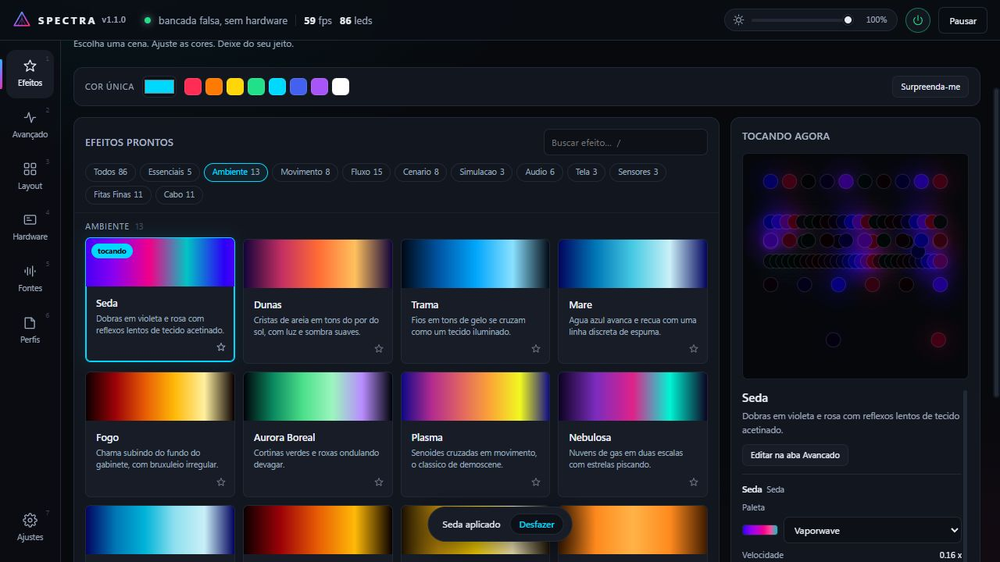

# Spectra

[](https://github.com/vinibotelho1998/Spectra/actions/workflows/release.yml)
[](LICENSE)

Controlador de RGB para Windows e Linux com motor de efeitos espacial próprio. Fala
diretamente o protocolo do [OpenRGB](https://openrgb.org) como camada de
hardware, e constrói por cima um motor de renderização, uma biblioteca com
mais de cem efeitos e uma interface web local — tudo neste repositório, sem
depender de nenhuma UI ou engine de terceiros.



## Por que existe

Softwares de fabricante (GIGABYTE Control Center, iCUE, Mystic Light,
L-Connect) só enxergam o próprio hardware, e o [OpenRGB](https://openrgb.org)
resolve isso muito bem como *camada de hardware* — mas para de propósito na
parte de efeitos, deixando isso para os clientes dele. O Spectra é um desses
clientes: assume o OpenRGB como transporte e foca inteiramente em fazer os
efeitos ficarem bons, incluindo o tipo que normalmente só aparece em produtos
fechados de um fabricante — as fitas de cabo estilo
[Lian Li Strimer](https://lian-li.com/product/strimer-plus-v2/), com
animações que atravessam a largura de várias lâminas ao mesmo tempo.

## Como instalar

### Windows

**Opção rápida:** baixe o instalador mais recente na
[aba Releases](../../releases/latest) e rode. O CI gera um instalador novo a
cada push na `main`.

**A partir do código-fonte:**

```powershell
git clone https://github.com/vinibotelho1998/Spectra.git
cd Spectra
python -m venv .venv
.venv\Scripts\pip install -r requirements.txt
.venv\Scripts\python run.py
```

Requer Windows 10/11 e o [OpenRGB](https://openrgb.org) instalado (o Spectra
sobe o servidor dele sozinho se encontrar em `C:\Program Files`).

### Linux

Instale o OpenRGB e permita que ele acesse seus dispositivos conforme as
[instruções oficiais do OpenRGB](https://openrgb.org/). O Spectra conecta ao
servidor SDK na porta 6742; inicie `openrgb --server` caso ele ainda não esteja
em execução. A interface local usa a porta 7311.

São necessários Python 3.12 ou mais recente com `venv` e `pip`, GTK 3, WebKitGTK e bindings Python
GObject para a janela, além de PulseAudio ou PipeWire com compatibilidade
PulseAudio para áudio. Em Debian/Ubuntu, por exemplo:

```bash
sudo apt install python3-venv python3-pip python3-gi gir1.2-gtk-3.0 gir1.2-webkit2-4.1 gir1.2-gstreamer-1.0 gstreamer1.0-pipewire libpulse0
```

Os nomes dos pacotes variam por distribuição. Use o Python da distribuição
para que o ambiente virtual possa acessar os bindings GObject instalados pelo
sistema. A partir do código-fonte:

```bash
git clone https://github.com/vinibotelho1998/Spectra.git
cd Spectra
./tools/install-linux.sh
```

O instalador cria `.venv` no repositório, instala as dependências Python e
adiciona o comando `~/.local/bin/spectra` e uma entrada no menu do usuário. O
repositório precisa permanecer no mesmo caminho. Também é possível executar
`.venv/bin/python run.py --browser` para usar o navegador, ou `--headless`
para executar sem janela. Para remover a instalação local, apague `.venv`,
`~/.local/bin/spectra` e `~/.local/share/applications/spectra.desktop` (ou os
respectivos caminhos XDG personalizados).

A captura de áudio depende de uma fonte de monitor disponível no PulseAudio ou
PipeWire. No X11 a captura de tela usa MSS; no Wayland ela usa o portal
ScreenCast, PipeWire e GStreamer. O sistema pede que você escolha uma tela e
autorize o compartilhamento a cada sessão de captura. A carga de GPU depende
do driver AMD expor `gpu_busy_percent` ou do utilitário NVIDIA `nvidia-smi`;
outros sensores dependem dos dados disponibilizados pelo sistema. No Wayland,
a bandeja usa StatusNotifier e AppIndicator; no KDE Plasma ela permite ocultar
a janela e reabri-la pelo ícone. É necessário o pacote AppIndicator ou Ayatana
com seu typelib GObject (por exemplo, `gir1.2-ayatanaappindicator3-0.1` no
Debian/Ubuntu), além de um desktop com host de bandeja. Se a bandeja não
estiver disponível, fechar a janela encerra o Spectra.

Para o teclado Akko suportado por HID direto (VID `3151`, PID `502d`),
o usuário precisa ter acesso ao dispositivo hidraw. Em sistemas com udev e
logind, crie `/etc/udev/rules.d/70-spectra-akko.rules` com:

```udev
SUBSYSTEM=="hidraw", ATTRS{idVendor}=="3151", ATTRS{idProduct}=="502d", TAG+="uaccess"
```

Recarregue as regras com `sudo udevadm control --reload-rules` e reconecte o
teclado. A regra `uaccess` concede acesso à sessão local ativa gerenciada pelo
logind; em outros ambientes, configure uma regra de grupo apropriada à sua
distribuição. Não é necessário executar o Spectra como root. Se a interface não
for identificada ou a abertura for negada, confira a regra, a sessão ativa e as
permissões do dispositivo `/dev/hidraw*`. O suporte HID no Linux precisa ser
validado com o dispositivo físico.

Para gerar uma pasta de distribuição no próprio Linux, instale PyInstaller no
ambiente virtual e execute `.venv/bin/pyinstaller spectra.spec`. O resultado
fica em `dist/Spectra`; as bibliotecas GTK/WebKit do sistema continuam sendo
necessárias. A compilação deve ser feita no sistema de destino ou em um Linux
compatível.

## O motor

**1. Todo LED é um ponto `(x, y)` num canvas.** Efeito nenhum sabe o que é
placa-mãe, fita ou fan — todos são funções `f(x, y, t) → RGB` vetorizadas em
numpy. Uma onda atravessa o gabinete inteiro na ordem física certa, e um
efeito novo custa ~15 linhas.

**2. Cada peça física tem sua própria coordenada local.** Um hub com 6 fans
chega ao OpenRGB como *uma* zona de 48 LEDs; tratada como linha única, um
efeito atravessaria os 6 fans como se fossem uma fita reta. Com a coordenada
`piece01`, cada fan mostra o efeito dando uma volta completa no anel e cada
fita mostra ele do início ao fim.

**3. Fitas de cabo ganham uma segunda dimensão.** Uma fita tipo Strimer não é
uma linha — são várias lâminas de acrílico lado a lado, cada uma com vários
LEDs. `piece_u`/`piece_v` dão a cada LED uma coordenada 2D dentro da peça, o
que é o que permite efeitos como *Cross Over* (dois feixes diagonais se
cruzando) ou *Paralelo* (lâminas acendendo em sequência).

## Arquitetura

```
spectra/core/protocol.py    protocolo binário do OpenRGB, implementado do zero
spectra/core/exclusive.py   instância única + encerra RGB concorrente
spectra/engine/canvas.py    mapa espacial: LED → (x, y), peças físicas 1D/2D
spectra/engine/renderer.py  pilha de camadas, mistura, loop a 60 fps
spectra/engine/palette.py   26 paletas + conversão de cor vetorizada
spectra/engine/noise.py     value noise 3D, fbm, turbulência
spectra/effects/            117 efeitos em 11 categorias
spectra/presets.py          97 cenas prontas
spectra/sources/            áudio (loopback WASAPI), tela (dxcam), sensores
spectra/app.py              estado, perfis, assistente, vigia de conexão
spectra/server.py           HTTP local + API + stream do quadro
spectra/tray.py             bandeja do sistema, fechar-minimiza
ui/                       interface (HTML/CSS/JS puro, sem build)
```

O OpenRGB é usado só como transporte, via seu protocolo de rede (implementado
do zero em `spectra/core/protocol.py`, sem depender de nenhuma lib GPL). O motor
de efeitos, a composição de camadas e a interface são todos deste projeto.

## Efeitos

**117 efeitos em 11 categorias**, cada um com seus próprios parâmetros
editáveis na interface — velocidade, paleta, cores, intensidade, e o que mais
fizer sentido para aquele efeito especificamente.

| Categoria | Qtd | Destaques |
|---|---|---|
| **Fluxo** | 14 | Pista, Neon, Cobra, Empilhar, Cascata, Maré — correm ao longo de cada peça |
| **Geométricos** | 18 | Cross Over, Prisma, Eclipse, Lótus, Lissajous, Trama — padrões espaciais e efeitos 2D para fitas de cabo |
| **Pixel** | 13 | Ponto Fino, Cometa Fino, Código — poucos LEDs acesos, borda seca |
| **Básicos** | 12 | Cor Sólida, Gradiente, Respiração, Chase, Vela |
| **Ondas** | 17 | Arco-Íris, Scanner, Espiral, Seda, Dunas, Hélice |
| **Ruído** | 11 | Plasma, Fogo, Aurora, Nebulosa, Lava Lamp, Voronoi |
| **Partículas** | 11 | Chuva, Neve, Meteoros, Raios, Fogos, Vaga-lumes, Constelação |
| **Simulação** | 6 | Game of Life, Reação-Difusão, Física de Ondas, Cardume |
| **Áudio** | 8 | Espectro, Pulso de Grave, Osciloscópio, Fogo Sonoro |
| **Sensores** | 4 | Cor por Temperatura, Barra de Carga, Alarme Térmico |
| **Tela** | 3 | Ambilight, Ambilight (bordas), Clima da Tela |

**97 presets prontos** aplicam uma cena completa com um clique; a grade mostra
por padrão os 86 mais refinados, com os mais intensos (estrobo, flashes)
escondidos atrás de "Mostrar todos". Camadas podem ser combinadas com 12 modos
de mistura na aba Avançado, e as fontes de áudio/tela/sensores ligam sozinhas
conforme as camadas ativas.

Os dez efeitos novos — **Seda, Prisma, Dunas, Eclipse, Lótus, Lissajous,
Trama, Maré, Hélice e Constelação** — têm presets próprios e movimento suave.
Velocidade zero congela o movimento e a cor; valores negativos invertem o
sentido. Paleta, intensidade e alvo podem ser ajustados sem montar outra cena.

## Interface

Sete abas, todas sobre o mesmo motor:

- **Efeitos** — a vitrine. Filtro por categoria, busca, favoritos que ficam
  salvos na configuração, uma barra de **cor única** para quando a vontade é só
  "deixa tudo laranja", e *Surpreenda-me*. O painel **Tocando agora** traz
  velocidade, paleta e cor da cena aplicada ali mesmo, sem precisar abrir o
  editor. Toda troca de cena mostra **Desfazer** por alguns segundos.
- **Avançado** — pilha de camadas com arrastar para reordenar, duplicar,
  ligar/desligar, alvo por dispositivo ou por zona, e os parâmetros completos
  do efeito selecionado.
- **Layout** — o mapa físico do gabinete, com as cores reais do efeito
  correndo por cima. **Piscar** acende uma zona sozinha no gabinete, que é como
  se descobre qual fita é qual. Setas do teclado fazem o ajuste fino.
- **Hardware** — o que o OpenRGB expõe, quantos LEDs cada conector tem, quem
  está em modo Direct e quem não está (e por quê).
- **Fontes** — áudio, tela e sensores, com espectro ao vivo e a cor média da
  tela para conferir que a captura está mesmo chegando.
- **Perfis** — a cena inteira salva por nome, para alternar entre cenas. A cena
  no ar volta sozinha ao abrir, com ou sem perfil.
- **Ajustes** — gama, taxa de quadros, suavização, modo exclusivo, início
  automático do OpenRGB e a lista de atalhos.

Atalhos: `Espaço` pausa, `/` busca, `Ctrl+1…7` troca de aba, `Esc` fecha o
seletor de efeitos.

O quadro chega na interface por **Server-Sent Events**, uma conexão só,
empurrando apenas quando a imagem muda — no lugar de um pedido HTTP a cada
33 ms.

## Assistente de LEDs

Não existe detecção automática de quantidade de LEDs — **o ARGB de 3 pinos é
mão única**, a fita nunca responde nada, nem para o software do próprio
fabricante da placa. O assistente reduz isso ao mínimo de perguntas:

1. **Inventário** — o que existe no gabinete, em linguagem humana
2. **Contagem** — busca binária **paralela** em todos os headers de uma vez
   (poucas perguntas no total, não uma série por header). Cada header acende
   *do índice testado até o fim*, na sua cor: um trecho é visível, um LED
   sozinho não
3. **Conferência** — acende tudo o que foi contado; se sobrar peça apagada, a
   contagem ficou baixa e dá para corrigir antes de aplicar
4. **Atribuição** — acende cada header inteiro: quais peças acenderam?
5. **Divisão** — com "48 LEDs" + "3 fans" o tamanho de cada fan sai por
   divisão, sem pergunta nenhuma; fitas de cabo também informam quantas
   lâminas paralelas têm, para os efeitos 2D funcionarem
6. **Aplicar** — grava as contagens e gera a geometria do mapa sozinho

## Robustez

- **Recuperação na inicialização.** A primeira falha também inicia o vigia:
  ele tenta novamente enquanto o Windows e o OpenRGB terminam de abrir. Se
  uma instância local do OpenRGB estiver sem SDK ou não detectar nenhum
  dispositivo no prazo, o Spectra tenta substituí-la uma vez, com o início
  automático habilitado e um executável ou tarefa disponível. Antes de subir
  outra, confirma que a anterior encerrou. O servidor elevado iniciado pela
  tarefa do Spectra também pode ser encerrado pelo próprio agendador.
- **Reconexão automática.** Se a conexão cair depois de funcionar, o vigia
  reconecta quando o servidor voltar. Fechar o OpenRGB manualmente depois de
  uma conexão bem-sucedida continua sendo respeitado.
- **Exclusividade.** Ao iniciar, encerra software de RGB concorrente
  (GIGABYTE, iCUE, Mystic Light, Aura, L-Connect, SignalRGB...) e minimiza a
  janela do OpenRGB — dois programas escrevendo no mesmo controlador é a causa
  clássica do gabinete inteiro piscando.
- **Instância única.** Um mutex nomeado impede duas cópias rodando ao mesmo
  tempo; abrir de novo mostra a janela existente, mesmo escondida na bandeja.
- **Zero troca de modo desnecessária.** Reenviar o modo Direct faz o
  controlador reinicializar a fita — uma piscada visível. Só é enviado quando
  o device ainda não está nele.
- **Fechar minimiza.** A bandeja do sistema mantém o app rodando e os efeitos
  animados; sair de verdade é uma opção explícita no menu dela. Iniciado com o
  Windows, o app sobe direto na bandeja (`--bandeja`), sem abrir a janela.
- **A janela abre na hora.** A conexão com o OpenRGB acontece numa thread à
  parte, então a interface aparece imediatamente mostrando "conectando" em vez
  de parecer travada por até vinte segundos na primeira execução.
- **Só a própria interface manda no app.** O servidor escuta apenas em
  loopback, mas qualquer site aberto no navegador também alcança loopback:
  pedidos de escrita com `Origin` de outra origem são recusados.

## Limitações conhecidas

- **Contagem de LEDs não é automática.** É uma limitação do protocolo ARGB em
  si (comunicação de mão única), não deste app — o assistente existe para
  tornar isso rápido, não para eliminar a pergunta.
- **Hardware sem suporte no OpenRGB não aparece.** Alguns fabricantes usam
  protocolos USB proprietários e não documentados; sem um driver do OpenRGB
  para aquele device, o Spectra também não o alcança. A exceção é o teclado
  Akko, abaixo.
- **Teclado Akko, por HID direto.** O OpenRGB não tem driver para a plataforma
  Rongyuan RY5088 que a Akko revende, então esses teclados seriam invisíveis.
  `spectra/core/akko.py` fala HID com eles diretamente, e é a única parte do
  projeto que não passa pelo OpenRGB.

  O teclado **acompanha a cena ao vivo**, com a cor dominante do efeito, a 60
  quadros por segundo. Isso usa o modo 21 do firmware, *Screen Sync*,
  alimentado pelo comando `0x0E` — o único canal do aparelho que aceita fluxo
  contínuo. Os outros dois, cor fixa (`0x07`) e camada por tecla (`0x0C`),
  reaplicam a iluminação a cada pacote e piscam de forma visível em qualquer
  taxa, de 8 a 207 quadros por segundo; o driver web do próprio fabricante
  também não transmite por eles.

  Cor por tecla existe, mas só como imagem parada (`SpectraApp.imagem_no_teclado`),
  e serve para destaque fixo — `tools/akko.py wasd` marca WASD e as setas, e
  sobrevive a desligar o PC. Animação por tecla exigiria firmware modificado.

  O formato do comando de fluxo e o mapa de comandos vieram da documentação do
  [monsgeek-akko-linux](https://github.com/echtzeit-solutions/monsgeek-akko-linux),
  que reverteu essa mesma família de teclados.
- **Temperaturas de CPU/GPU são opcionais.** No Linux, dependem dos sensores
  expostos pelo sistema; a carga da GPU depende do driver AMD ou do
  `nvidia-smi`. No Windows, temperaturas dependem de
  `LibreHardwareMonitorLib.dll` (não incluída — baixe em
  [github.com/LibreHardwareMonitor/LibreHardwareMonitor](https://github.com/LibreHardwareMonitor/LibreHardwareMonitor)),
  procurada em `vendor/` dentro da pasta de configuração, que no app instalado
  é `%LOCALAPPDATA%\Spectra\vendor`, e depois em `vendor/` ao lado do código.
  Sem ela, os efeitos de sensor funcionam com uso de CPU/RAM via `psutil`, e
  as temperaturas aparecem como indisponíveis — nunca inventadas; a aba Fontes
  e a vitrine dizem onde colocar o arquivo.
- **RAM, SSD e GPU via SMBus/I²C no Windows exigem o OpenRGB elevado.** Sem privilégio
  administrativo o OpenRGB não abre o barramento (`Permission Denied, PawnIO
  initialization aborted` no log dele) e os pentes de memória simplesmente não
  aparecem na lista. O Spectra resolve isso sozinho: na primeira abertura
  registra a tarefa agendada `Spectra - OpenRGB SDK Server`, com privilégio
  máximo, e daí em diante sobe o servidor por ela — o aviso do controle de
  conta aparece uma vez só. Se o servidor já estiver no ar sem privilégio, a
  aba Hardware mostra o aviso com o botão **Corrigir**, que registra a tarefa e
  reinicia o servidor elevado. O barramento também depende do driver
  [PawnIO](https://pawnio.eu); faltando ele, o aviso diz isso. No Linux,
  o barramento precisa estar disponível e acessível ao usuário. Consulte
  [SMBus Access do OpenRGB](https://gitlab.com/CalcProgrammer1/OpenRGB/-/blob/master/Documentation/SMBusAccess.md)
  quando os módulos não aparecerem.

## Empacotamento

O instalador é gerado automaticamente pelo GitHub Actions
(`.github/workflows/release.yml`) a cada push na `main`: builda o `.exe` com
PyInstaller e empacota com Inno Setup. Para rodar o mesmo processo localmente:

```powershell
pip install pyinstaller
pyinstaller spectra.spec --noconfirm
iscc installer\spectra.iss /DMyAppVersion=1.0.0
```

O executável instalado grava config e perfis em `%LOCALAPPDATA%\Spectra`,
nunca na própria pasta de instalação — funciona sem privilégio de
administrador mesmo instalado em `Program Files`.

## Desenvolvimento e validação

```powershell
.venv\Scripts\pip install -r requirements-dev.txt
.venv\Scripts\python -m pytest
node --test tests/test_frontend.js
.venv\Scripts\python tools/smoke.py
.venv\Scripts\python tools/uidev.py
```

`uidev` usa uma bancada simulada e uma configuração separada. Os testes de
conexão, recuperação de inicialização e API usam mocks, sem controlar os LEDs.
As regressões da interface usam o executor de testes do Node.js, sem instalar
dependências JavaScript.
O workflow `Tests` valida pull requests no Windows e no Linux; o workflow de release também executa
a suíte antes de gerar o instalador.

## Ferramentas de diagnóstico

```
tools/probe.py           lista tudo que o OpenRGB expõe
tools/modes.py           mostra o modo real de cada device (--fix força Direct)
tools/blackout.py        expande os headers ao máximo e apaga tudo
tools/identify.py        pinta cada zona de uma cor: mapeia peça → controlador
tools/hidscan.py         nomes reais dos dispositivos HID conectados
tools/smoke.py           roda todos os efeitos sem hardware e valida a saída
tools/srctest.py         testa áudio, tela e sensores isoladamente
tools/uidev.py           sobe a interface com hardware falso, sem tocar nos LEDs
tools/uicheck.py         abre a UI real e interroga o DOM por dentro
tools/reconnect_test.py  derruba o OpenRGB e verifica a recuperação
tools/dump.py             hexdump do blob de um controlador
tools/akko.py            teclado Akko por HID direto, fora do OpenRGB
```

## Licença

[MIT](LICENSE). O Spectra fala o protocolo de rede do OpenRGB via uma
implementação própria e independente (não usa nem vincula código do OpenRGB),
então não herda a licença GPL-2.0 dele.

O que ele usa de terceiros está listado no [NOTICE.md](NOTICE.md).
